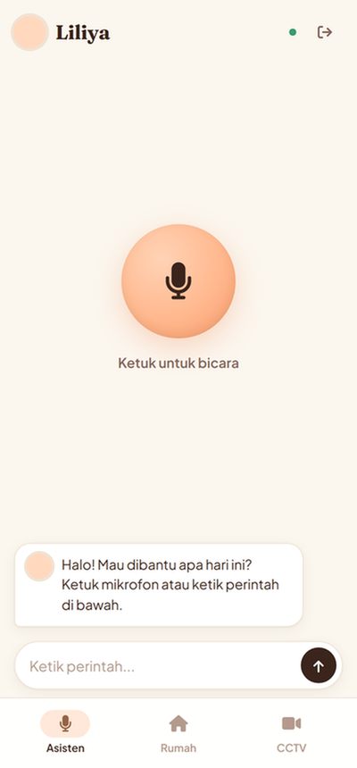
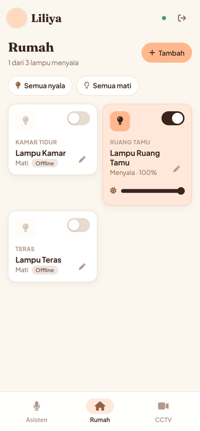
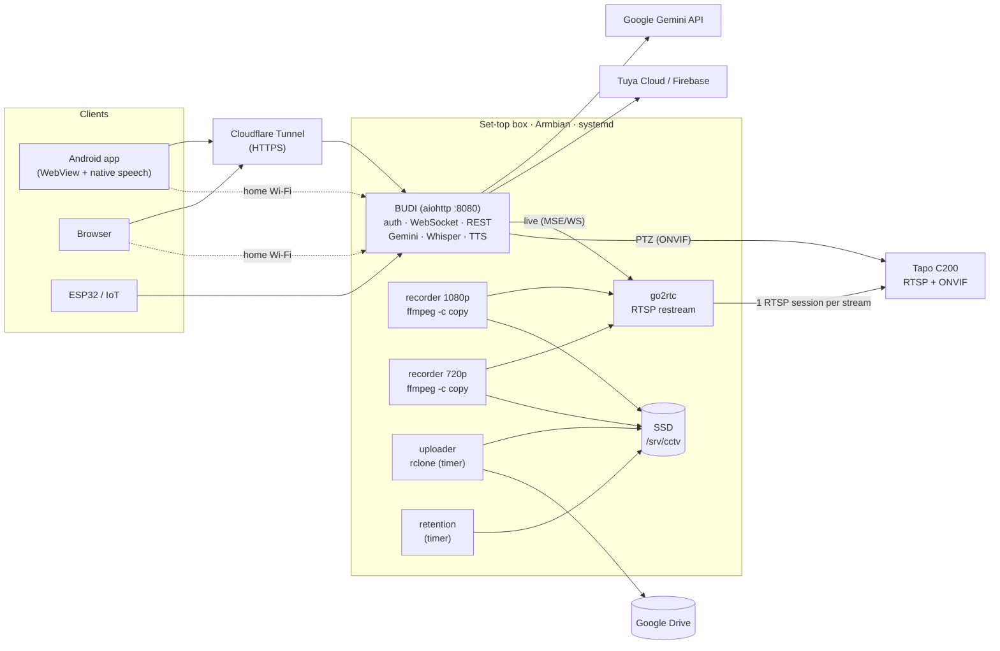

# BUDI — Self-Hosted Smart Home Hub on a Recycled TV Set-Top Box

**BUDI** turns a discarded ISP set-top box (Amlogic S905X, 4× Cortex-A53, **1.9 GB RAM**) into a
24/7 smart home hub: an AI voice assistant powered by Google Gemini, manual smart-home switches,
a CCTV recorder (NVR) with live view, pan-tilt and Google Drive backup, plus a native Android app.
Everything runs on the box itself; both 24/7 video recorders together use about 4% of total CPU.


<p align="center">
  
  &nbsp;&nbsp;
  
</p>

---

## Why this project is interesting

- **Real constraints, real hardware.** A 2016-era TV box runs an
  AI assistant, speech-to-text, a web dashboard, two 24/7 video recorders and a cloud uploader at
  the same time — with ~1.2 GB RAM still free and a load average around 0.2–0.5.
- **Every design decision was measured, not guessed.** Bitrates, CPU usage, encoder throughput and
  upload bandwidth were benchmarked on the device before choosing an approach (see
  [Engineering decisions](#engineering-decisions)).
- **Production concerns, not just a demo:** authentication for internet exposure, systemd services
  with memory limits, automatic retention, verified cloud uploads, signed APK releases via CI.

## Measured on the device

| Metric | Value |
|---|---|
| Hardware | Amlogic S905X (4× Cortex-A53 @ 1.5 GHz), 1.9 GB RAM, Armbian / Ubuntu 24.04, kernel 6.18 |
| Assistant process (Gemini + Whisper STT + web server) | ~200 MB RAM, ~0% CPU when idle |
| CCTV stack (go2rtc + 2 recorders) | ~140 MB RAM, ~2% of total CPU per recorder |
| RAM still available with everything running | ~1.2 GB |
| 1080p recording | ~1.6 Mbps → ~17 GB/day, kept 3 days on SSD |
| 720p cloud backup | ~0.5 Mbps → ~5.2 GB/day → 5 TB Google Drive lasts ~2.9 years |
| Live view through the internet (720p) | ~465 kbps including audio |
| Software H.264 re-encode on this CPU (benchmark) | only 1.0–1.2× real time on all 4 cores → **rejected** |
| Android APK size | **19 KB** (no third-party libraries) |

## Features

### 🎙️ AI voice assistant
- **Google Gemini with function calling** (14 tools): smart-home control and status, YouTube and
  radio playback, weather, timers, volume, system status, time, and Islamic prayer times.
- **Speech-to-text on the device** with `faster-whisper` (tiny, int8, beam search tuned for Indonesian),
  plus an optional offline wake word using a Vosk keyword grammar.
- **Natural neural text-to-speech** with Edge TTS, with filler phrases to hide network latency.
- **Resilience:** rotates across multiple API keys and falls back across several Gemini models when
  one is rate-limited or unavailable.
- **Automatic prayer-time announcements** (adzan playback) for the configured city.

### 🏠 Smart home
- Manual switches grouped by room, brightness slider, AC temperature and fan speed, "all lights on/off".
- **Device management (CRUD) from the app:** add devices straight from the user's Smart Life account
  (listed with online status), rename, move rooms, set voice nicknames, re-link or delete. New devices
  are immediately controllable by voice, with validation and duplicate protection on the server.
- **State sync from Tuya:** online/offline (with a grace period, because Bluetooth sub-devices behind a
  gateway report flapping status) and on/off when the device reports it. Polls every 15 s only while
  someone has the app open, every 5 min otherwise, batching all devices into one API call.
- Real-time state shared between voice commands, the web UI and the app over **WebSocket**.
- Device state synchronized to **Firebase Realtime Database**; physical Bluetooth bulbs controlled through
  the **Tuya Cloud API** via a Tuya Bluetooth gateway.
- REST API (`/api/devices`, `/api/device/{id}`) with API-token auth for ESP32 / IoT clients.

### 📹 CCTV / NVR (TP-Link Tapo C200)
- **Live view** in the browser and the app via **go2rtc** (Media Source Extensions over WebSocket),
  with a data-saver (720p) and HD (1080p) mode.
- **Pan-tilt control** through a hand-written **ONVIF SOAP client** (WS-Security UsernameToken digest).
- **24/7 recording** in 10-minute MP4 segments, browsable by date and hour, auto-plays the next segment,
  downloadable from the app.
- **Google Drive backup** of every segment (720p), uploaded every 10 minutes with a bandwidth cap;
  local copies are deleted only after the checksum matches in Drive. Drive copies are never deleted.
- Backup status and a **"Drive almost full" warning** shown in the app.

### 📱 Android app
- Minimal Java app (Android 8+) wrapping the dashboard in a WebView, plus:
  - **native Android speech recognition** bridged to JavaScript (WebView has no Web Speech API),
  - fullscreen video with landscape rotation, authenticated downloads via `DownloadManager`,
  - external links (YouTube) opened in their own apps, switchable server URL (internet / home Wi-Fi).
- **Built, signed and published by GitHub Actions** on every change to `android/`.

### 🔐 Security
- Cookie session login (HMAC-signed, `HttpOnly`, `SameSite=Lax`) with brute-force lockout.
- Requests from the home LAN / Tailscale are trusted; **traffic from the Cloudflare Tunnel always
  arrives from localhost and is never trusted**, so it must log in.
- go2rtc's admin API (which can reveal camera credentials) is **not exposed**: BUDI proxies only a
  whitelist of player files and the WebSocket for configured stream names.
- Path-traversal-safe recording file serving; secrets live only in an ignored `config.yaml`.

## Architecture



## Engineering decisions

| Problem | Decision | Why |
|---|---|---|
| Compress video for cloud storage | Record the camera's own **720p sub-stream** instead of re-encoding | Benchmarked `libx264` on the box: 1.0–1.2× real time on all 4 cores, which would pin the CPU 24/7. The camera's sub-stream gives a 3.3× smaller archive at ~2% CPU. |
| Hardware encoder | Not used | The S905X has a hardware video encoder, but it was not usable through FFmpeg on the mainline kernel running on this box. |
| Corrupted recordings after a camera Wi-Fi drop | Use **wall-clock timestamps** in the recorder; repair broken files by rebuilding timestamps (`setts`) without re-encoding | On reconnect the camera restarts its RTP clock; copying those timestamps produced 8-minute files reported as 0.5 s long. |
| Several consumers of one Wi-Fi camera | **go2rtc** keeps a single RTSP session per stream, shared by live view and recorders | The camera limits concurrent sessions and has limited Wi-Fi bandwidth. |
| Uploads stalled with `RATE_LIMIT_EXCEEDED` | Dedicated Google OAuth client, `drive.file` scope only | The default rclone client is shared worldwide; `drive.file` lets the uploader see only the files it created. |
| Never lose footage during uploads | `rclone move` with checksum verification; local retention never touches the upload queue | A file leaves the SSD only after Google Drive confirms an identical MD5. |
| Howling sound in live view | Live view starts **muted**, with an explicit sound toggle | Diagnosed by FFT analysis of the audio: the tone drifted in frequency (acoustic feedback between the phone speaker and the camera mic). |
| Exposing the dashboard to the internet safely | Trust by network origin + signed session cookie | Cloudflare Tunnel connects from `127.0.0.1`, so loopback is explicitly untrusted. |
| Voice input inside the Android app | Native `SpeechRecognizer` bridged through `@JavascriptInterface` | Android WebView does not implement the Web Speech API. |
| Tuya API quota & flapping status | Adaptive polling (15 s while the app is open, 5 min idle), one batched call for all devices, 60 s offline grace period | Measured the Bluetooth gateway toggling offline/online roughly every minute in the Tuya cloud. |
| Low-RAM device | No Docker daemon on the box; systemd units with `MemoryMax`, `Nice`, idle I/O priority | Each service's memory is capped so a misbehaving process cannot starve the assistant. |

## Tech stack

**Backend:** Python 3.12, asyncio, aiohttp (HTTP + WebSocket), Google Gen AI SDK, faster-whisper,
Vosk, Edge TTS, PyAudio/ALSA, mpv, yt-dlp, tinytuya, Firebase REST.
**Video:** go2rtc, FFmpeg (segment muxer, stream copy), ONVIF (SOAP), rclone.
**Frontend:** vanilla JavaScript, HTML, CSS (responsive, no framework), Media Source Extensions.
**Mobile:** Android (Java, WebView, SpeechRecognizer, DownloadManager), Gradle.
**Ops:** Armbian Linux, systemd services and timers, Cloudflare Tunnel, Tailscale,
GitHub Actions (signed APK releases, multi-arch Docker image to GHCR).

## Project structure

```
main.py                  # wiring: audio, STT, TTS, Gemini, skills, web server
core/
  gemini_brain.py        # Gemini chat + function calling, key rotation, model fallback
  stt.py / tts.py        # faster-whisper speech-to-text, Edge neural TTS
  wakeword.py            # optional offline wake word (Vosk keyword grammar)
  web_server.py          # aiohttp: dashboard, WebSocket, REST API
  web_auth.py            # session login, trusted networks, API tokens, lockout
  cctv.py                # recordings API, go2rtc live proxy, ONVIF pan-tilt, backup status
  smart_home_db.py       # device state store + realtime broadcast
  firebase_bridge.py / tuya_bridge.py
skills/                  # tools exposed to Gemini: smart home, media, weather, timer, system, prayer times
web/                     # dashboard (assistant, home, CCTV tabs) and login page
android/                 # Android app (Java, no third-party dependencies)
deploy/cctv/             # go2rtc config, recorder/uploader/retention scripts, systemd units
docs/APK_CCTV.md         # setup guide for the app, CCTV and Google Drive backup
.github/workflows/       # APK build & release, Docker image to GHCR
```

## Getting started

1. Install Armbian on an Amlogic S905X box (ZTE B860H / Fiberhome HG680P), then run `scripts/install.sh`.
2. Copy `config.example.yaml` to `config.yaml` and fill in the Gemini API key(s), the city, and optionally
   Tuya / Firebase, `web_auth` and `cctv` (see [docs/APK_CCTV.md](docs/APK_CCTV.md)).
3. `sudo systemctl enable --now stb-assistant` and open `http://<box-ip>:8080`.
4. For CCTV and Google Drive backup, install the units in `deploy/cctv/` as described in
   [docs/APK_CCTV.md](docs/APK_CCTV.md).
5. Download the Android app from the **Releases** page.

Example voice commands (Indonesian): *"Nyalakan lampu teras"*, *"Putar lagu Sheila on 7 di YouTube"*,
*"Bagaimana cuaca hari ini?"*, *"Pasang timer 3 menit"*, *"Kapan sholat berikutnya?"*

## Known limitations & roadmap

- Tuya does not report on/off state for these Bluetooth bulbs with the project's current instruction mode,
  so changes made outside BUDI (Smart Life app, wall switch) are only reflected once Tuya reports them.
- The free Edge TTS endpoint has started rejecting requests (HTTP 403); evaluating an update or an
  offline TTS fallback.
- Planned: motion-event timeline for recordings, push notifications, multi-camera layout.

## Author

**Ahmad Fazri Nursamsi** — [GitHub @AhmadFazriNursamsi](https://github.com/AhmadFazriNursamsi)
